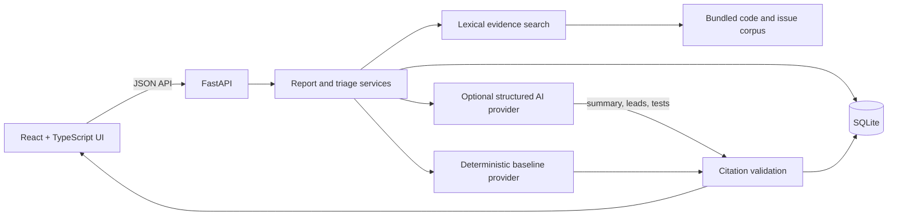
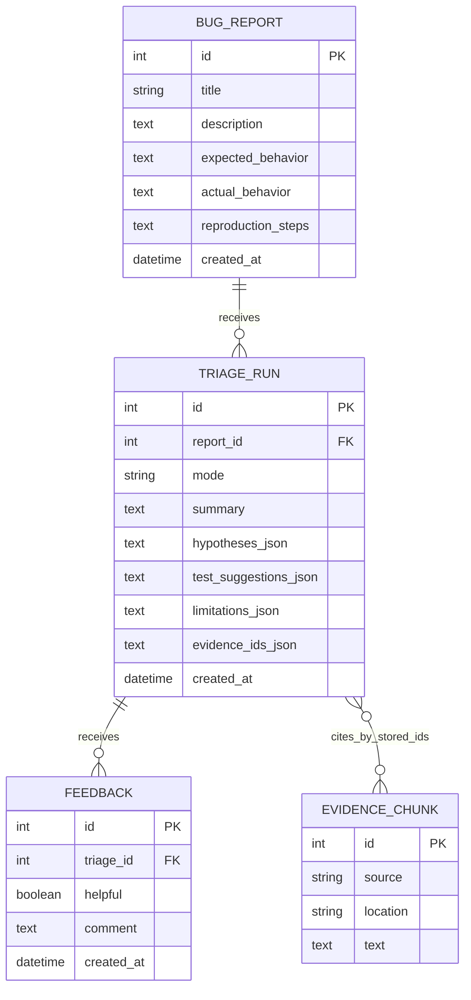

# DevLens Architecture

## Components and data flow

The browser submits reports and requests triage through JSON endpoints. FastAPI validates requests and stores user data in SQLite. For a triage request, the backend ranks matching corpus chunks, sends only the report and selected evidence to the chosen provider, validates every returned evidence ID against that retrieval result, and persists the output. The response includes the referenced snippets so the UI can show them beside the suggestions.

## Entity relationship view

Evidence references are stored as IDs in each triage run and validated in the backend; they are not a separate relational join table in the MVP.

## Modules

- **Report management:** validates, stores, lists, and displays bug reports.
- **Evidence retrieval:** loads the sample corpus, removes common stopwords, ranks exact token matches, and returns stable source references.
- **Triage providers:** generates baseline guidance locally or structured AI suggestions when configured.
- **Citation validation:** rejects references that were not part of the current retrieval result and omits uncited cause hypotheses.
- **Feedback:** stores helpful/not helpful responses with an optional comment.
- **Presentation layer:** React components communicate with the backend through a typed API client.

## Main data entities

- **BugReport:** title, description, expected and actual behavior, optional reproduction steps, and creation time.
- **EvidenceChunk:** stable ID, source path or issue, location, and text.
- **TriageRun:** report, mode, summary, hypotheses, test suggestions, limitations, referenced evidence IDs, and creation time.
- **Feedback:** triage run, helpful/not helpful value, optional comment, and creation time.

## API surface

- `GET /api/health`
- `POST /api/reports`, `GET /api/reports`, `GET /api/reports/{report_id}`
- `POST /api/reports/{report_id}/triage`, `GET /api/reports/{report_id}/triage`
- `POST /api/triage/{triage_id}/feedback`

## Reliability and trust

Request schemas trim and validate report text. Unknown report or triage IDs return `404`. A no-evidence result returns a limitation and no cause hypotheses. Optional provider failures return a recoverable error while preserving the bug report. The backend rejects any citation that does not belong to the evidence retrieved for that run. Local baseline mode needs no API credentials.

## Limitations and future work

The sample corpus is intentionally small; keyword retrieval can miss semantic matches and does not index arbitrary repositories. Future work could add user-approved repository ingestion, stronger retrieval, authentication, and evaluation against a labeled dataset. Production use would also require access controls, privacy review, and operational monitoring.
